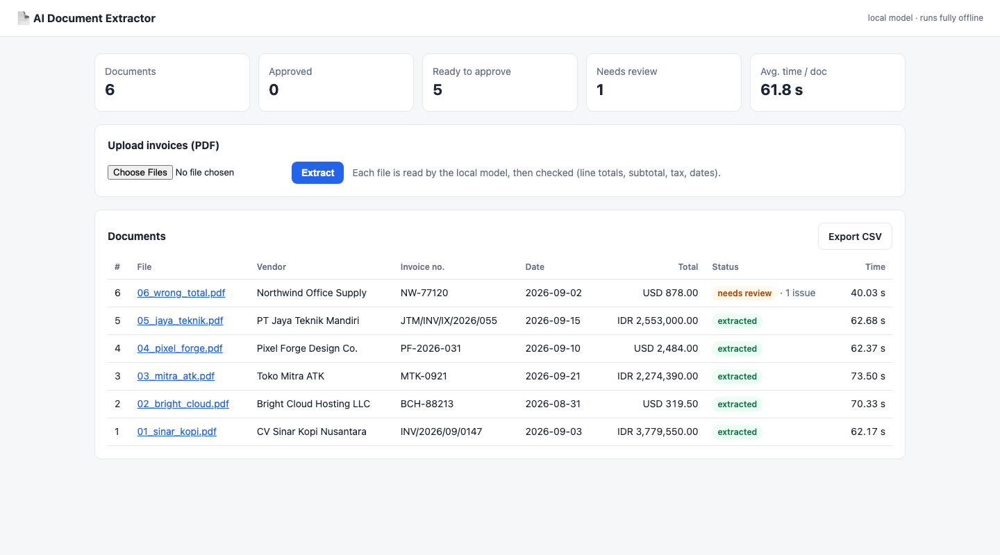
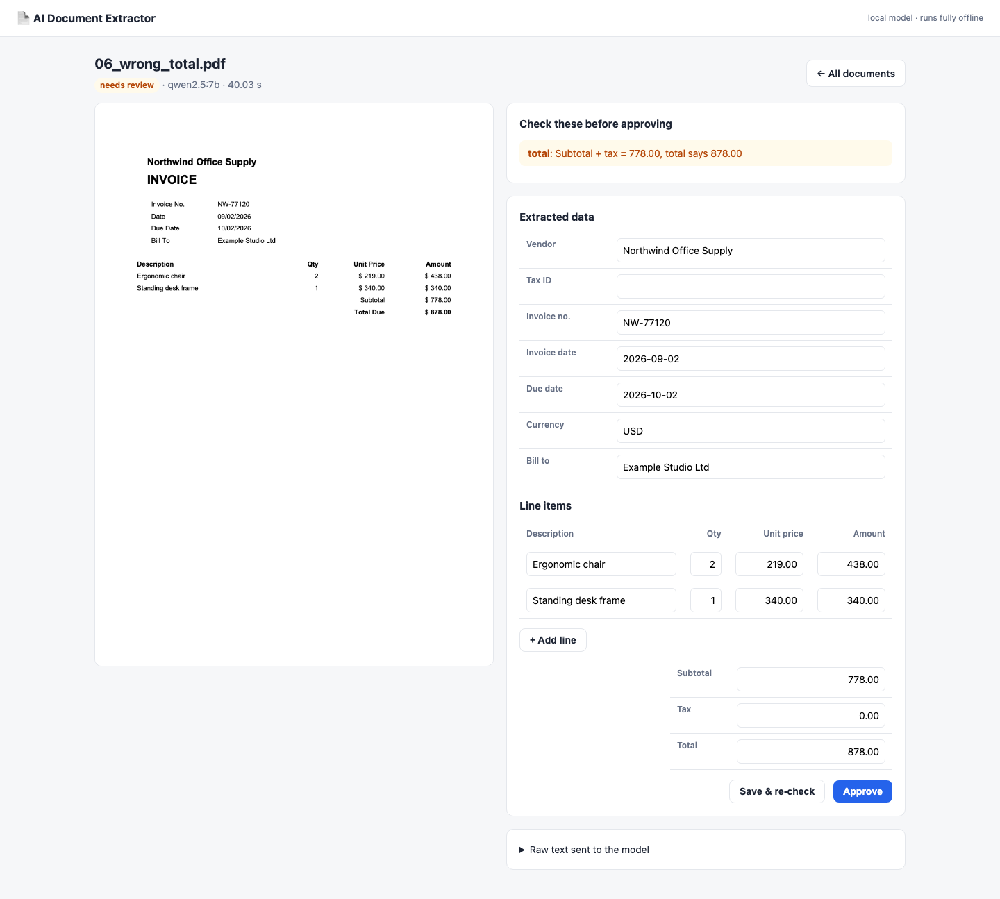

# AI Document Extractor: invoices → PostgreSQL, with a local LLM

Upload invoice PDFs and get clean, validated data in PostgreSQL. A reviewer only looks at the documents that need it.

- Runs **fully offline** with a local model (Ollama + `qwen2.5:7b`). No document leaves the machine, which matters for finance and HR data.
- **100% field accuracy** on the included test set: 60/60 header fields and 20/20 line items, across Indonesian and English invoices, IDR and USD, and four different date formats. See [docs/evaluation.md](docs/evaluation.md).
- **Validation catches what the model can't**, including a document that is itself wrong: `06_wrong_total.pdf` has a printed total that doesn't add up, and it is flagged for review.





## How it works

```
PDF ──► text with columns kept ──► local LLM (JSON schema) ──► normalise in code ──► validate ──► PostgreSQL
            pdfplumber                Ollama structured output      dates, currency      arithmetic,     jsonb + view
                                                                                         dates, required
                                                                    ┌─────────────────────────┘
                                                                    ▼
                                         no issues → "extracted"    issues → "needs review" → human edits → approve
```

**1. Keep the table layout.** Plain PDF text turns a row like `Biji kopi arabika Gayo 1 kg │ 12 │ Rp 185.000` into `...Gayo 1 kg 12 Rp 185.000`. The model then can't tell the "1" in "1 kg" from the quantity. Extracting with the layout preserved (and compacting the spaces into `|` separators) fixed every line-item error.

**2. Let the model read; let code decide.** The model fills a strict JSON schema with values copied *as printed*. Anything that needs rules is done in Python ([`app/normalize.py`](app/normalize.py)):
- **Dates.** `09/10/2026` is 9 October on an Indonesian invoice and September 10 on a US one. The code detects the document language and parses accordingly. An unambiguous value like `21/09` always wins.
- **Currency.** `Rp` becomes IDR and `$` becomes USD.
- **Missing fields.** Small models often answer `null` for nullable fields they could have read. The schema asks for required strings ("empty if absent") and converts empty strings to null afterwards.

These two changes took header accuracy from 78% to 100% and line items from 85% to 100% on the same files.

**3. Validate like an accountant** ([`app/validate.py`](app/validate.py)): quantity × unit price = amount, lines sum to the subtotal, subtotal + tax = total, dates are real, and the due date is not before the invoice date. Rounding within 1 unit is allowed. Any issue sends the document to review with the reason shown.

**4. Human in the loop.** The review screen shows the PDF next to editable fields. Saving re-runs validation. Approving stamps `reviewed_at`.

## Features

- Upload several PDFs at once. Processing runs in the background and the list refreshes itself.
- Duplicate uploads are detected by SHA-256 and processed only once.
- Review screen with PDF preview, issue list, editable header and line items.
- `GET /export.csv` exports every invoice through the `v_invoices` SQL view, ready for Excel or a BI tool.
- JSON API for integrations (n8n, Zapier, your backend):
  - `POST /api/extract`: send a PDF (`file`) or raw text (`text`) and get data + issues back, without storing anything.
  - `GET /api/documents/{id}`
  - Interactive docs at `/docs` (FastAPI).
- Scanned PDFs without a text layer fail with a clear message. Adding OCR (e.g. Tesseract) is the natural next step.

## Quick start

Requires Python 3.10+, Docker and [Ollama](https://ollama.com).

```bash
ollama pull qwen2.5:7b
docker compose up -d                       # PostgreSQL on localhost:5546
python -m venv .venv && source .venv/bin/activate
pip install -r requirements-dev.txt

uvicorn app.main:app --reload              # http://localhost:8000
```

Upload the PDFs from `samples/`, or call the API:

```bash
curl -F file=@samples/02_bright_cloud.pdf localhost:8000/api/extract
```

```bash
pytest                                     # 26 tests, model mocked, no Ollama needed
python scripts/evaluate.py                 # accuracy on samples/ with the real model
python scripts/generate_samples.py         # rebuild the sample invoices
```

Settings (environment variables or `.env`): `DATABASE_URL`, `OLLAMA_URL`, `MODEL`, `UPLOAD_DIR`, `AMOUNT_TOLERANCE`.

## Speed and model choice

On an Apple Silicon laptop with 16 GB RAM, a one-page invoice takes about 25 to 60 seconds with `qwen2.5:7b`, depending on what else is running. That is fine for a back-office queue processed in the background. For higher volume:
- use a GPU server, or
- point `OLLAMA_URL` at a bigger machine, or
- swap `call_llm` for a hosted API (one function).

The validation and review flow stays the same.

## Sample data

All invoices in `samples/` are generated by `scripts/generate_samples.py`. Vendors, tax IDs and amounts are fictional. `samples/expected.json` holds the correct answer for each file.

## Layout

```
app/extract.py      PDF -> text -> model -> RawInvoice
app/normalize.py    RawInvoice -> Invoice (dates, currency, empties)
app/validate.py     business checks -> list of issues
app/db.py           PostgreSQL (documents table + v_invoices view)
app/main.py         FastAPI: web UI, review, CSV export, JSON API
app/templates/      Jinja2 pages
scripts/            sample generator, accuracy evaluation
tests/              pytest (model mocked)
```

## Tech

Python · FastAPI · Ollama (qwen2.5:7b, structured outputs) · pdfplumber · Pydantic · PostgreSQL (jsonb) · Jinja2 · pytest · Docker
